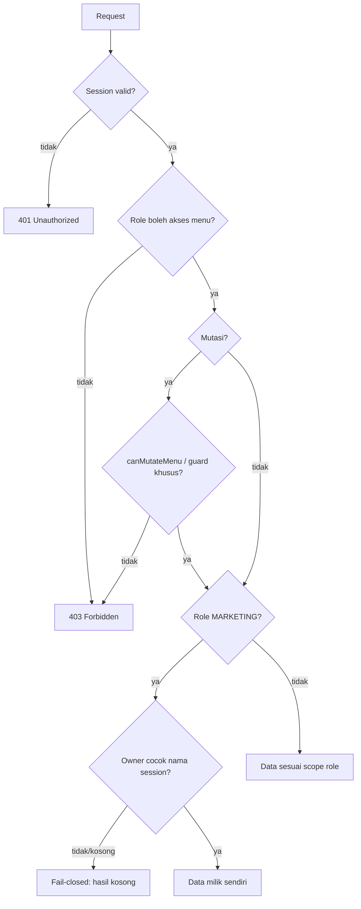

# HR/RBAC REMAP — IMPLEMENTATION REPORT

**Proyek:** web-psb-perkasa
**Branch:** main
**Baseline HEAD:** `da92a6d` — `feat(hr): tampilkan absensi per karyawan dengan filter bulan (v1.9.1)`
**Sifat perubahan:** Pemetaan ulang RBAC (menu, mutasi, scope data) + penegakan owner Marketing side server
**Status:** Implementasi selesai di working tree — **belum di-commit, belum di-push, belum deploy**

> Catatan: laporan ini disusun dari verifikasi aktual pada working tree (bukan asumsi). Tidak ada operasi tulis ke database production.

---

## GATE 0 — Baseline & Boundary

| Item | Nilai |
|---|---|
| Repo | `C:\Users\user\Documents\trae_projects\WEB PSB PERKASA\web-psb-perkasa` |
| Branch | `main` |
| HEAD (belum berubah) | `da92a6d` |
| Commit/push/deploy dalam sesi ini | Tidak ada |
| Migrasi akun | Tidak ada (alias role dipertahankan) |
| Operasi DB production | Tidak ada |

---

## GATE 1 — Matriks Role

Sumber tunggal kebijakan: `src/lib/access.ts`.

| Role | Akses menu | Hak mutasi | Catatan |
|---|---|---|---|
| DEVELOPER | Semua modul + semua pengaturan | Semua | Satu-satunya role yang boleh `db-update`; konfigurasi mesin fingerprint. Level tertinggi. |
| ADMIN | Semua modul + semua pengaturan | Semua modul & pengaturan | **Kecuali** mesin fingerprint dan `db-update` |
| PRIORITY | Semua modul (read) | Tidak ada | Kontrol aksi disembunyikan di UI, bukan hanya ditolak API |
| HR | Dashboard, Aktivitas Marketing, HR | HR (karyawan + operasi absensi) | Aktivitas Marketing read-only; tanpa konfigurasi mesin |
| MARKETING | PSB, Aktivitas Marketing, Isolir, Dismantle, ODP, Trouble Ticket, HR | Input PSB saja | Data dibatasi miliknya sendiri (owner) |
| CS | Input/List PSB, Isolir, Dismantle, ODP, Trouble Ticket | Sesuai menu | |
| ADMIN_CS | Sama dengan CS | Sama dengan CS | Diuji setara penuh |
| NOC | List PSB, Dismantle, ODP, Trouble Ticket | Sesuai menu | |
| TEKNISI | List PSB, Dismantle, ODP, Trouble Ticket | Sesuai menu | Mengambil alih Trouble Ticket + Dismantle |
| TROUBLESHOOTS / DISMANTLE | Sama dengan TEKNISI | Sama dengan TEKNISI | **Alias legacy**, tanpa migrasi akun |
| CREATOR_DIGITAL | Modul digital + beberapa modul operasional | Sesuai menu | |

**Developer-only (mesin fingerprint & db-update):** `isDeveloperRole`, `canReadFingerprintMachine`, `canConfigureFingerprintMachine`. `isAdminRole()` (Admin + Developer) **tidak** dipakai untuk membentuk kebijakan Developer-only.

---

## GATE 2 — Penegakan Kebijakan



Kebijakan ditegakkan berlapis: **matriks akses** (`access.ts`), **guard API handler**, **server page guard**, **proxy**, dan **kontrol UI**.

---

## GATE 3 — Scope Owner Marketing (fail-closed)

| Modul | Sumber owner | Lokasi kunci |
|---|---|---|
| PSB | Nama Marketing (normalisasi + exact match) | `api/tickets/route.ts`, `api/tickets/[id]/route.ts`, `api/tickets/[id]/photo/route.ts`, `api/tickets/import/route.ts`, `lib/tickets-list-cache.ts` |
| Isolir | Field `marketing` (exact, case-insensitive) | `api/isolations/route.ts` |
| Dismantle (ticket & history) | Field `marketing` | `lib/dismantle-tickets.ts`, `lib/dismantle-history.ts`, `api/dismantle-tickets/route.ts`, `api/dismantle-history/route.ts` |
| Trouble Ticket | `createdById` dari session | `api/trouble-tickets/[id]/route.ts`, `[id]/close`, `bulk-delete`, `import`, `photos/[photoId]` |
| Absensi / Karyawan HR | `Employee.userId` | `api/hr/employees/route.ts`, `api/hr/attendance/route.ts` |

Aturan fail-closed:
- Nama owner session kosong → query ditutup (`id < 0` / `1 = 0`), tidak menampilkan data.
- Record tanpa owner eksplisit (legacy) → tidak tampil untuk Marketing.
- Field fingerprint ID disamarkan (`null`) untuk Marketing.

Helper: `isMarketingOwnerMatch()` di `src/lib/marketing-users.ts` (nama session wajib tidak kosong dan cocok setelah normalisasi).

---

## GATE 4 — Hasil Audit Guard (sesi ini)

Audit jalur mutasi Isolir/Dismantle berbasis ID, bulk, dan import:

- `api/isolations/route.ts` — POST/DELETE → `canMutateIsolationRecords` / `canDeleteIsolationRecords` (MARKETING dikecualikan).
- `api/isolations/[id]/route.ts` — PUT/DELETE → guard yang sama.
- `api/isolations/import/route.ts`, `api/isolations/dismantle-import/route.ts` → `canMutateIsolationRecords`.
- `api/dismantle-tickets/route.ts` (DELETE), `api/dismantle-history/route.ts` (DELETE) → `canDeleteIsolationRecords`.
- `api/dismantle-tickets/[id]/route.ts`, `api/dismantle-history/[id]/reopen`, `close`, `import`, `transfer` → `canMutateMenu(..., 'dismantle')`.

Kesimpulan: role baca (terutama MARKETING) tidak memiliki jalur mutasi pada Isolir/Dismantle; scope owner diterapkan pada query list/detail. **Tidak ada perubahan kode yang diperlukan** pada jalur ini.

---

## GATE 5 — Daftar File Terdampak

### API (`src/app/api`)
```
admin/db-update/route.ts
dismantle-history/route.ts
dismantle-tickets/route.ts
hr/attendance/route.ts
hr/employees/route.ts
hr/machine/route.ts
isolations/route.ts
marketing-activities/route.ts
tickets/[id]/photo/route.ts
tickets/[id]/route.ts
tickets/import/route.ts
tickets/route.ts
trouble-tickets/[id]/close/route.ts
trouble-tickets/[id]/route.ts
trouble-tickets/bulk-delete/route.ts
trouble-tickets/import/route.ts
trouble-tickets/photos/[photoId]/route.ts
trouble-tickets/route.ts
users/route.ts
```

### Library (`src/lib`)
```
access.ts          (matriks role + helper)
marketing-users.ts (helper owner)
tickets-list-cache.ts
dismantle-tickets.ts
dismantle-history.ts
hr-schema.ts
db-init.ts
validations.ts
trouble-ticket-photo-store.ts   (retensi foto)
```

### UI / Halaman
```
src/proxy.ts
src/components/{CapacitorBackHandler,CoveredAreaManager,DashboardLayoutClient,Header,
  HrAttendanceView,HrEmployeesView,MobileNavigation,PackageManager,PriorityManager,
  Sidebar,TemplateManager,TroubleTicketIdManager,TroubleTicketMasterManager,
  TroubleTicketSlaManager,TroubleTicketView,UsersClient}.tsx
src/app/(dashboard)/{dismantle,hr,trouble-ticket}/page.tsx
src/app/(dashboard)/settings/{areas,packages,priorities,role-audit,templates,trouble-ticket}/page.tsx
```

### Skema
```
prisma/schema.prisma
```
Relasi kepemilikan Trouble Ticket via `createdById`; `Employee.userId` (1-1 ke User). Self-healing schema menambah kolom/index/FK.

### Baru (untracked)
```
src/lib/access.test.ts
src/lib/photo-retention-policy.ts
src/lib/photo-retention-policy.test.ts
src/lib/photo-retention.ts
src/app/api/cron/photo-retention/
scripts/run-photo-retention.js
PHOTO_RETENTION_REPORT.md
scripts/update_ticket_schema.ts   ← DIKECUALIKAN dari commit rutin
```

---

## GATE 6 — Bukti Verifikasi

| Pemeriksaan | Hasil |
|---|---|
| `npx tsx --test src/lib/access.test.ts src/lib/photo-retention-policy.test.ts` | **16/16 lulus** |
| `npx tsc --noEmit` | Lulus (tanpa error) |
| `npx eslint <file terdampak>` | **0 error**, 5 warning lama di komponen lain (Analytics/Campaign/ContentCalendar/DigitalLead) |
| `npm run build` | Kompilasi sukses, TypeScript build lulus, 51 halaman + `/hr/employees` tergenerate |

Tes RBAC mencakup: matriks menu/mutasi Admin & Developer, PRIORITY read-only, HR, MARKETING (nodashboard), fingerprint/db-update Developer-only, operasi absensi, ADMIN_CS=CS, alias TEKNISI, dan owner match fail-closed. Tes baru mencakup guard Isolir/Dismantle, Trouble Ticket (Marketing read-only & Teknisi mutasi), dan ODP.

Catatan build: exit code non-zero **hanya** berasal dari pemblokiran TRAE Sandbox pada tulis cache `C:\Users\user\AppData\Local\prisma-nodejs\Cache\last-generate` dan `checkpoint-nodejs`, bukan kegagalan kompilasi/build.

---

## GATE 7 — Keterbatasan & Catatan

- Tes ownership menguji helper dan matriks (unit test). **Belum ada integration test** yang menjalankan route handler terhadap data/database nyata.
- Retensi foto operasional 6 bulan dipertahankan (`trouble-ticket-photo-store.ts`, `photo-retention*`, cron route).
- `scripts/update_ticket_schema.ts` tetap untracked dan **dikecualikan** dari commit rutin.
- `.git/index.lock` dilaporkan dipindahkan Windows ke Recycle Bin. Jika diperlukan operasi git tulis, user perlu memulihkannya manual dari Recycle Bin (asisten tidak memulihkan lewat tooling).

---

## GATE 8 — Langkah Berikutnya (menunggu instruksi)

1. Review lokal / uji visibilitas menu per role di dev server.
2. Commit lokal (tanpa file yang dikecualikan) dengan format `fix(scope)`/`feat(scope)`.
3. Push ke GitHub setelah persetujuan eksplisit.
